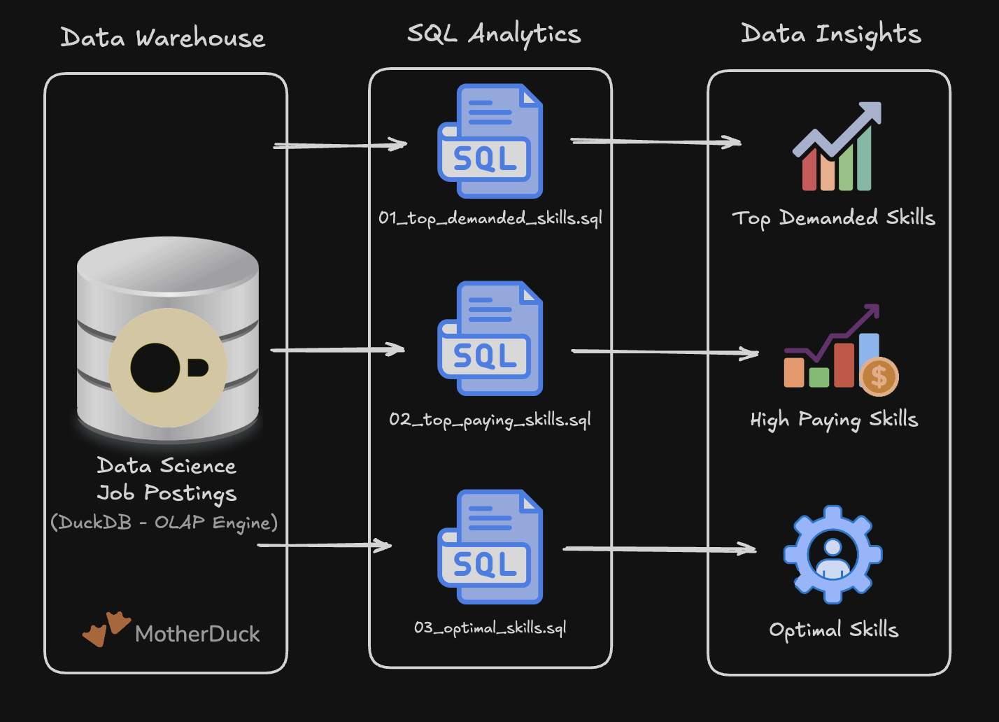

# 🔍 Exploratory Data Analysis w/ SQL: Remote Data Engineer Job Market



A SQL project analyzing the remote Data Engineer job market using real-world job posting data. This project demonstrates my ability to **navigate a star-schema data warehouse, write analytical SQL in DuckDB, and turn raw job data into actionable career insights**.

---

## 🧾 Executive Summary

- ✅ **Project scope:** Built **3 analytical queries** to evaluate skill demand, salary trends, and optimal career ROI for remote Data Engineers  
- ✅ **Data modeling:** Queried across fact, dimension, and bridge tables (`1.62M` job postings expanding to `7.48M` joined skill rows)  
- ✅ **Analytics:** Applied **medians, filtering (`WHERE` vs. `HAVING`), and logarithmic scaling (`LN`)** to balance high pay against job availability  
- ✅ **Outcomes:** Identified **SQL & Python** as non-negotiable foundations, and **Terraform, AWS, Airflow, & Spark** as the highest-value skills to pair with them  

If you only have a minute, review these scripts:

1. [`01_top_demanded_skills.sql`](./01_top_demanded_skills.sql) – Demand analysis across remote postings using multi-table `INNER JOIN`s  
2. [`02_top_paying-skills.sql`](./02_top_paying-skills.sql) – Median salary analysis using `HAVING` to filter out low-volume noise  
3. [`03_optimal_skills.sql`](./03_optimal_skills.sql) – Combined demand & salary ranking using natural log (`LN`) normalization  

---

## 🧩 Problem & Warehouse Architecture

When planning what to learn in Data Engineering, looking at demand or salary in isolation is misleading. This project answers three connected questions:

- 🎯 **Most In-Demand:** *Which skills show up the most in remote Data Engineer postings?*  
- 💰 **Highest Paid:** *Which skills command the highest median salaries (without being skewed by 1–2 rare job posts)?*  
- ⚖️ **Best Trade-Off (Optimal):** *How do we mathematically combine salary and demand so huge job counts don't drown out high-paying tools?*  

To answer these, I queried a **Star Schema Data Warehouse** hosted on **MotherDuck**:


- **Fact Table (`job_postings_fact`):** Central table containing `1.62M` job postings with titles, remote status (`job_work_from_home`), and salaries (`salary_year_avg`).
- **Dimension Tables:** 
  - `company_dim` – Company details linked via `company_id`.
  - `skills_dim` – Catalog of skill names (`sql`, `python`, `terraform`, etc.) linked via `skill_id`.
- **Bridge Table (`skills_job_dim`):** Connects `job_id` to `skill_id`. *(Note: Joining the fact table to this bridge table creates a **join fan-out** from `1.62M` rows to `7.48M` rows because a single job posting typically requires multiple skills).*

---

## 🧰 Tech Stack

- 🐤 **Query Engine & Cloud Warehouse:** DuckDB CLI connected to MotherDuck (`md:data_jobs`)  
- 🧮 **Language:** SQL (Aggregations, Mathematical Functions, Multi-Table Joins)  
- 📊 **Data Model:** Star schema (Fact + Dimension + Bridge tables)  
- 🛠️ **Development Environment:** VS Code + Git Bash (Windows 11)  
- 📦 **Version Control:** Git & GitHub  

---

## 📂 Repository Structure

```text
1_EDA/
├── 01_top_demanded_skills.sql    # Top 10 most requested skills for remote Data Engineers
├── 02_top_paying-skills.sql      # Top 25 highest-paying skills (filtered for >100 postings)
├── 03_optimal_skills.sql         # Log-normalized score balancing median salary and demand
└── README.md                     # Project documentation and findings
```

---

## 🏗 Analysis & Why I Calculated Things This Way

### 1. [Top Demanded Skills](./01_top_demanded_skills.sql)
- **Approach:** Joined `job_postings_fact`, `skills_job_dim`, and `skills_dim` using `INNER JOIN`, filtered for `job_title_short = 'Data Engineer'` and `job_work_from_home = True`, and ranked the top 10 skills by `COUNT()`.
- **Findings:** 
  - 🧠 **SQL (`29,221`)** and **Python (`28,776`)** are virtually tied at the top, proving both are mandatory for remote Data Engineers.
  - ☁️ **AWS (`17,823`)** and **Azure (`14,143`)** lead cloud demand, followed by core pipeline/compute tools: **Spark (`12,799`)**, **Airflow (`9,996`)**, **Snowflake (`8,639`)**, and **Databricks (`8,183`)**.

### 2. [Top Paying Skills](./02_top_paying-skills.sql)
- **Why I calculated it this way:**
  - **Used `MEDIAN()` instead of `AVG()`:** Salary data often has extreme high or low outliers; `MEDIAN(salary_year_avg)` gives a much truer middle figure.
  - **Used `HAVING skill_count > 100`:** Without a minimum threshold, a niche skill appearing in only 2 job postings paying `$200k` would top the chart. Filtering after the `GROUP BY` removes rare outliers.
- **Findings:**
  - 🦀 Niche systems languages like **Rust (`$210,000`)** and **Golang (`$184,000`)** top the pay scale, alongside infrastructure tool **Terraform (`$184,000`)**.
  - 🚀 **Airflow (`$150,000` across `9,996` postings)**, **Kubernetes (`$150,500` across `4,202` postings)**, and **Terraform (`3,248` postings)** stand out for offering `$150k+` pay with high market volume.
  - ⚠️ However, foundational skills like SQL and Python don't appear in the Top 25 here because their median salaries are slightly lower—which led directly to Query 3.

### 3. [Optimal Skills (Demand × Salary)](./03_optimal_skills.sql)
- **Findings:**
  - 🏆 **Terraform (`0.97`)** ranks #1 overall, balancing an `$184k` median salary with solid remote demand (`193` salaried postings).
  - 🔥 **Python (`0.95`)**, **SQL (`0.91`)**, **AWS (`0.91`)**, **Airflow (`0.89`)**, **Spark (`0.87`)**, and **Snowflake (`0.82`)** immediately follow, confirming them as the highest-ROI stack to master.
  - 📉 Because `LN()` still penalizes very tiny job counts, ultra-niche skills like **Rust (`23` salaried jobs)** naturally drop to the bottom (`0.66`) without even needing a `HAVING` filter.

---

## 💻 SQL & Engineering Skills Demonstrated

### Query Design & Optimization
- **Multi-Table Joins:** Chaining `INNER JOIN`s across fact, bridge, and dimension tables.
- **Statistical Aggregations:** Using `COUNT()`, `MEDIAN()`, and `ROUND()` for clean reporting.

### 🛠️ Technical Challenges & Query Engineering Iterations

- **Iterating the Optimal Score Metric:**  
  My initial attempt to rank overall skill value used a naive linear product (`median_salary * demand_count`). This created an extreme volume bias: foundational skills like SQL and Python (~1,100 salaried postings) completely drowned out high-value specialized tools like Terraform (193 postings), effectively turning the ranking into another raw demand list. To normalize the skewed distribution, I introduced a natural log transformation:

$$
\text{optimal\_score} = \text{ROUND}\left(\frac{\text{MEDIAN}(\text{salary\_year\_avg}) \times \ln(\text{COUNT}(*))}{1,000,000}, 2\right)
$$

  This compressed the volume range (e.g., $1,133 \rightarrow \sim7.0$ vs. $193 \rightarrow \sim5.0$), allowing compensation to meaningfully drive the rank while preserving statistical weight for volume.

- **Mitigating Metric Drift Across Join Aggregations:**  
  In early drafts of Query 3, omitting `salary_year_avg IS NOT NULL` caused subtle metric drift: `COUNT(*)` was tallying the total job postings matched through the bridge table, whereas `MEDIAN(salary_year_avg)` implicitly skipped `NULL`s. Explicitly filtering for non-null salaries in the `WHERE` clause ensured both metrics were derived from the exact same cohort of postings.

- **Handling Join Fan-Out on Multi-Table Aggregations:**  
  Joining `job_postings_fact` ($1.62\text{M}$ rows) to `skills_job_dim` caused an intentional fan-out to $7.48\text{M}$ rows due to the one-to-many relationship between postings and skills. Understanding this expansion was critical to applying filters (`job_title_short`, `job_work_from_home`) before or during grouping, preventing redundant processing overhead across non-target job titles.

- **Execution Order Constraints (`WHERE` vs. `HAVING`):**  
  Early query drafts attempted to filter aggregates directly inside `WHERE` clauses (e.g., filtering out low-frequency skills). Resolving this reinforced the database engine's logical query processing pipeline: row-level predicates execute early in `WHERE`, while post-aggregation thresholds belong in `HAVING`.